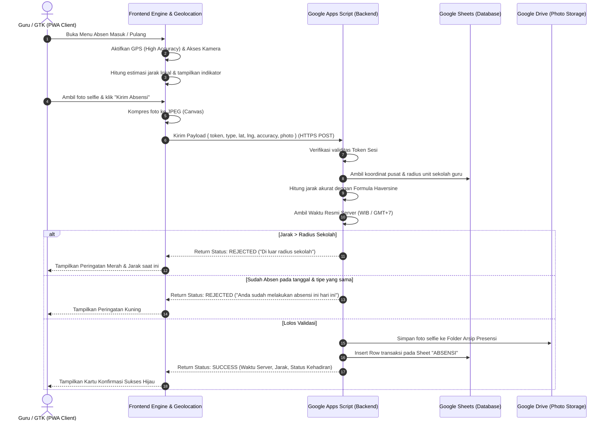

# 2. DESAIN ARSITEKTUR APLIKASI
## APLIKASI ABSENSI ONLINE GURU DAN TENAGA KEPENDIDIKAN BERBASIS GPS
### PERGURUAN ISLAM NIBRAS

---

### 2.1 Arsitektur Tingkat Tinggi (High-Level Architecture)

Aplikasi dibangun dengan arsitektur **Decoupled Serverless Jamstack / PWA**:
- **Presentation Tier**: Progressive Web App (HTML5, Modern Vanilla CSS3, ES6+ JavaScript, Leaflet.js untuk peta interaktif) yang di-deploy pada GitHub Pages / Web Server HTTPS.
- **Application & Logic Tier**: Google Apps Script Web App (GAS) bertindak sebagai serverless RESTful API yang mengeksekusi validasi bisnis (autentikasi, validasi jarak Haversine, pengecekan waktu server, manajemen file foto di Google Drive, dan kontrol akses).
- **Data & Storage Tier**: Google Sheets bertindak sebagai basis data tabular relasional, didukung oleh Google Drive untuk penyimpanan file foto bukti presensi selfie.

```
+-------------------------------------------------------------+
|                     PWA FRONTEND CLIENT                     |
|  (Smartphone Android / iPhone / Tablet / Desktop Browser)    |
|                                                             |
|  - Service Worker & Cache Storage (Offline & PWA Install)   |
|  - HTML5 Geolocation API (High-accuracy GPS Coordinates)   |
|  - MediaDevices WebRTC / Canvas (Selfie Photo Capture)     |
|  - Leaflet.js Map Viewer (Visualisasi Radius & Posisi)      |
|  - State Management & REST Client (Fetch API via HTTPS)     |
+------------------------------+------------------------------+
                               |
                   HTTPS POST / GET (JSON)
                               |
                               v
+-------------------------------------------------------------+
|                 GOOGLE APPS SCRIPT WEB APP                  |
|                 (Serverless Backend Engine)                 |
|                                                             |
|  - Router & Dispatcher (doGet / doPost)                     |
|  - Security & Auth Engine (SHA-256 + Salt, Session Tokens)  |
|  - Geo Engine (Server-side Haversine Distance Calculation)  |
|  - Rule Validator (Jam Masuk/Pulang, Radius Toleransi)      |
|  - Duplicate Guard (Mencegah absensi ganda hari berjalan)   |
|  - Image Processor (Penyimpanan foto selfie ke Drive)       |
+------------------------------+------------------------------+
                               |
               Google Workspace Script Services
                               |
                               v
+-------------------------------------------------------------+
|                 GOOGLE SHEETS & GOOGLE DRIVE                |
|                    (Data & Media Storage)                   |
|                                                             |
|  - Sheet "USERS"      : Akun, password hash, salt, role     |
|  - Sheet "GURU"       : Biodata identitas GTK & relasi unit |
|  - Sheet "SEKOLAH"    : Data unit sekolah, koordinat, radius|
|  - Sheet "ABSENSI"    : Catatan transaksi presensi & link   |
|  - Sheet "PENGATURAN" : Konfigurasi operasional sistem      |
|  - Sheet "LOGS"       : Audit log aktivitas admin           |
|  - Google Drive Folder: Arsip foto selfie harian            |
+-------------------------------------------------------------+
```

---

### 2.2 Diagram Alur Presensi (Attendance Transaction Flow)



---

### 2.3 Formula Haversine (Server-Side Geodesic Calculation)

Untuk menghitung jarak jarak lingkaran besar (great-circle distance) antara dua koordinat bola bumi:

$$\Delta\phi = \text{lat}_2 - \text{lat}_1$$
$$\Delta\lambda = \text{lon}_2 - \text{lon}_1$$
$$a = \sin^2\left(\frac{\Delta\phi}{2}\right) + \cos(\text{lat}_1) \cdot \cos(\text{lat}_2) \cdot \sin^2\left(\frac{\Delta\lambda}{2}\right)$$
$$c = 2 \cdot \text{atan2}\left(\sqrt{a}, \sqrt{1 - a}\right)$$
$$d = R \cdot c$$

Dimana:
- $R$ adalah radius rata-rata bumi = $6.371.000\text{ meter}$.
- $\text{lat}_1, \text{lon}_1$ adalah koordinat posisi pengguna (derajat dikonversi ke radian).
- $\text{lat}_2, \text{lon}_2$ adalah koordinat referensi titik sekolah (derajat dikonversi ke radian).
- $d$ adalah jarak dalam satuan meter.

---

### 2.4 Kebijakan Keamanan (Security Measures)

1. **Hashing Password**: Menggunakan algoritma SHA-256 dipadu dengan *salt* acak unik per pengguna. Password asli tidak pernah tersimpan di Google Sheets.
2. **Session Token**: Token berbasis UUID dan waktu kedaluwarsa (misal berlaku 7 hari), diverifikasi pada setiap request yang membutuhkan otorisasi.
3. **Server-Side Verification**: Koordinat GPS dikirim bersama akurasi; backend Apps Script menghitung ulang jarak secara independen tanpa bergantung pada perhitungan sisi frontend.
4. **Authoritative Timestamp**: Waktu presensi murni diambil dari `new Date()` pada runtime server Apps Script, bukan jam perangkat smartphone yang mudah digeser oleh pengguna.
5. **Role-Based Access Control (RBAC)**: Endpoint admin dibatasi ketat; Guru hanya dapat melihat dan mengambil riwayat akun miliknya sendiri.

